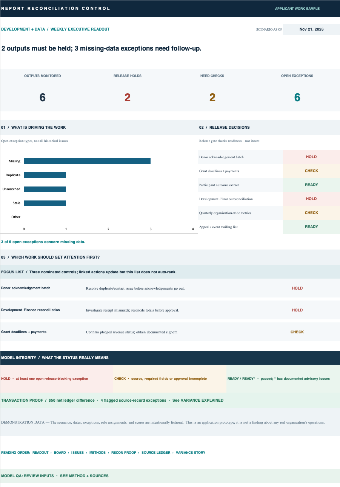

# Report Reconciliation Control

**A $50 gap can hide $330 in differences that still need an answer.**

An Excel control system for a nonprofit fundraising team. It checks the records behind a total before the report goes out.

*The Executive Readout sheet: which reports are ready, held, or need a check.*

Built by Brian Rodriguez as a work sample, November 2026. All gift records are fictional. This is not a finding about any real organization.

## The problem

Two totals can almost match while single gifts are missing, counted twice, posted in the wrong month, or unexplained.

| Gift list | Finance records | Net gap | Amount to check |
|---:|---:|---:|---:|
| $2,090 | $2,140 | +$50 | **$330** |

| What needs an answer | Difference | What to do next |
|---|---:|---|
| Gift amount differs | −$50 | Compare the receipt with both amounts. |
| Gift missing in Finance | −$90 | Check for a posting after month end. |
| One gift has two postings | +$110 | Check for a valid split or a duplicate. |
| Finance entry has no gift | +$80 | Find its source, then link or correct it. |

The four differences add up to only +$50. Their sizes add up to $330. That is not lost money. It is the amount that needs an explanation.

## The fix: four steps before a number goes out

1. **Match.** Connect each gift to a Finance posting by gift ID, or by a documented deposit group. Check dates.
2. **Flag.** List missing, extra, changed and split entries, with their impact.
3. **Assign.** Record who fixes each issue, by when, and what proof closes it.
4. **Decide.** A reviewer signs off, pauses the report, or asks a manager. Any exception is written down.

## What is in the workbook

`Reporting_Control_Workbook.xlsx` has 9 sheets:

| Sheet | What it does |
|---|---|
| Executive Readout | One page answer: which reports are ready, blocked, or need a decision |
| Control Board | Every report with deadline, data source, owner, reviewer and status |
| Issue Register | Each open issue with owner, due date and the proof needed to close it |
| Reconciliation Proof | Matches up to 60 gifts against 60 Finance postings with live formulas |
| Source Ledger | The Finance side input, one row per posting |
| Variance Explained | Why the net total misses offsetting errors |
| FY26 Public Context | Figures from a real nonprofit's public annual report, name removed |
| Requirements Map | Each reporting duty mapped to its source, check and proof, then traced to the control that satisfies it and that control's live release gate. Four duties show NO CONTROL: the coverage gap, on purpose. |
| Method + Sources | How it works, the scoring rule, and the limits |

Type new fictional entries into the blue cells and the result columns recalculate.

## A 30 day pilot plan

- **Days 1 to 10, agree on the rules.** Confirm deadlines, source data, privacy rules, matching rules and who signs off.
- **Days 11 to 20, test real records.** With staff, check a sample, match one month, keep proof and assign issues.
- **Days 21 to 30, hand over the tools.** Deliver the control board, issue log, release checklist and the top recurring fixes.

**How to measure it.** Baselines come from the day 1 to 10 sample. Targets are proposals until the team confirms them.

| Measure | Baseline | Proposed 30 day target | Checked | By |
|---|---|---|---|---|
| Gifts matched or logged as an issue, out of gifts sampled | Count in days 1 to 10 | 100% | Monthly, at tie out | Development + Finance |
| Thank you notes sent on time | Count in days 1 to 10 | Set once the team confirms its turnaround standard | Weekly | Development reviewer |
| High risk issues past their due date | Count on day 10 | 0 | Weekly | Issue owner, checked by reviewer |
| Reports signed off before release, out of reports due | Count in days 1 to 10 | 100% | Each release | Reviewer |

Read the trend from baseline, not one week's number.

## Limits

The example data, owners, rules and scores are illustrative. A real team would confirm its own definitions, permissions and funder rules before using this.
